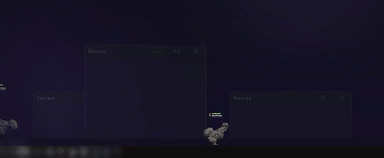
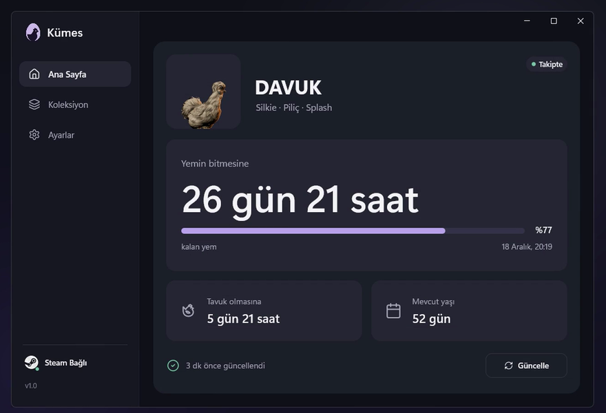

# Kümes

CS2'deki evcil tavuğun Windows masaüstünde, görev çubuğunun üstünde 3D olarak yaşar. Yürür, eşelenir, uyur, pencerelerin üstüne tüner. Yemin ne zaman biteceğini de gösterir.

*Your CS2 pet chicken lives on your Windows desktop, in 3D, above the taskbar. [English below.](#english)*



## İndir

**[Kümes'in son sürümü (Windows, 64 bit)](https://github.com/enes-topcam/kumes-desktop/releases/latest)**

1. `Kumes-x.y.z-win-x64.zip` dosyasını indir ve bir klasöre çıkar.
2. `Kumes.exe`'yi çalıştır. .NET kurman gerekmez.
3. Steam'e giriş yap ya da "Giriş yapmadan dene"ye tıkla.

Windows "bilinmeyen yayımcı" uyarısı verirse "Ek bilgi" → "Yine de çalıştır" de. Exe imzalı değil.

**Gerekenler:** Windows 10 ya da 11 (64 bit) ve envanterinde bir CS2 tavuğu.

## Neler var

- Oyundaki tavuk modeli, rengi ve animasyonları
- Yem ve büyüme durumu, yem bitmeden bildirim
- Steam'e QR kod ya da kullanıcı adı + Steam Guard ile giriş
- Giriş yapmadan dene: Steam'e bağlanmadan örnek bir tavukla uygulamayı gör
- Birden fazla Steam hesabı ve koleksiyon
- CS2 açıkken tavuk kendiliğinden gizlenir
- Ekranın yenileme hızına göre akıcı çizim, az RAM (~25 MB)
- Türkçe ve İngilizce arayüz (Ayarlar → Dil)



## Tavuk modeli nereden geliyor

Pakette Valve'a ait hiçbir dosya yok. İlk açılışta model, renkler ve animasyonlar senin bilgisayarında hazırlanır:

- **CS2 kuruluysa:** Dosyalar kendi CS2 kurulumundan çıkarılır (yaklaşık 1 dakika).
- **CS2 kurulu değilse:** Sadece tavuk dosyaları (~110 MB) senin Steam hesabınla Valve'ın içerik sunucusundan indirilir. Oyunun tamamı inmez.

İki durumda da dosyalar sadece bu bilgisayarda kalır (`%APPDATA%\KumesCS`).

## Hesabın

- Şifren yalnızca Steam'e gider, Kümes kaydetmez. Bu bilgisayarda sadece Steam'in verdiği oturum anahtarı, Windows'un kendi şifrelemesiyle saklanır.
- Kümes, Steam'e ayrı bir cihaz olarak bağlanır. Birkaç saniye "CS2 oynuyor" görünür ve envanterindeki tavuğu okur. Takas, satın alma, mesaj gibi hiçbir şey yapmaz. CS2'de oyundaysan araya girmez.
- Tamamen kaldırmak için: Steam mobil uygulamasında Steam Guard → yetkili cihazlar listesinden "Kümes Masaüstü"nü kaldır.

## Kaynaktan derleme

[.NET 10 SDK](https://dotnet.microsoft.com/download) gerekir.

```
dotnet build cs/Kumes -c Release
```

Exe `cs/Kumes/bin/Release/net10.0-windows/Kumes.exe` olarak çıkar. Çift tıklayıp açmak için `Kumes-baslat.vbs` de kullanılabilir.

CS2 kurulumundan model çıkarmak için [Source 2 Viewer](https://github.com/ValveResourceFormat/ValveResourceFormat) komut satırı aracı gerekir. `Source2Viewer-CLI.exe` ve yanındaki dosyaları exe'nin yanındaki `tools/vrf/` klasörüne koy (geliştirirken depo kökündeki `tools/vrf/` da olur). Bu araç yoksa ve Steam'e giriş yapılmışsa, tavuk dosyaları hesapla indirilir.

## English

Kümes puts your CS2 pet chicken on your Windows desktop. It walks, pecks, sleeps and perches on your windows, and shows when its feed runs out.

1. Download the [latest release](https://github.com/enes-topcam/kumes-desktop/releases/latest) (`Kumes-x.y.z-win-x64.zip`) and unzip it.
2. Run `Kumes.exe`. No .NET install needed. If Windows shows "unknown publisher", click "More info" → "Run anyway" (the exe isn't signed).
3. Sign in to Steam (QR code or username + Steam Guard), or click "Try without signing in".

You need Windows 10 or 11 (64-bit) and a chicken in your CS2 inventory. The chicken model is prepared on your PC: from your CS2 install, or, without CS2, downloaded from Valve with your own Steam account (~110 MB). The UI follows your Windows language; change it in Settings → Language.

Your password goes only to Steam and is never saved. Kümes connects as a separate Steam device, shows as "Playing CS2" for a few seconds and reads your chicken. It never trades, buys or sends messages. To remove it, open Steam Guard in the Steam mobile app and remove "Kümes Masaüstü" from your authorized devices.

Not affiliated with Valve or Steam.

## Lisans

[MIT](LICENSE). Valve ve Steam ile resmi bir bağlantısı yoktur. Counter-Strike, CS2 ve Steam, Valve Corporation'ın ticari markalarıdır.
